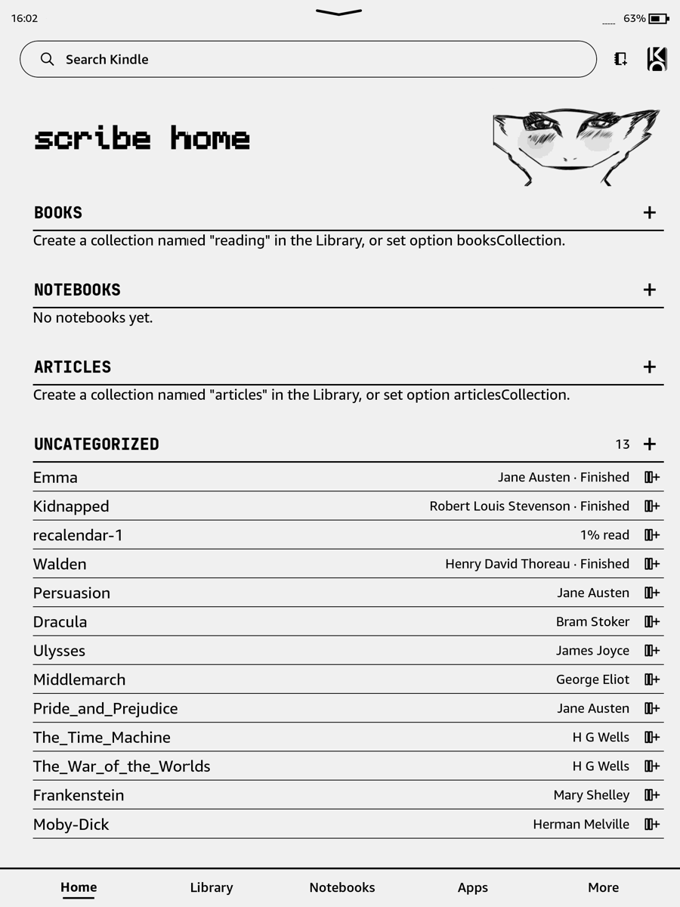

# k4 Home — a custom Home screen for the Kindle Scribe

[](https://github.com/k4rnaj1k/kindle-scribe-custom-home/releases/latest)

A [kppmods](https://github.com/katadelos/kppmods) extension that replaces the
content of the Kindle Scribe's Home screen with a library dashboard.

<table>
<tr>
<td align="center" width="50%"></td>
<td align="center" width="50%"></td>
</tr>
<tr>
<td align="center"><sub>Set up: collections, notebooks and a calendar (an earlier build, titled "k4 library").</sub></td>
<td align="center"><sub>Right after installing, before any setup: each section says what it is looking for.</sub></td>
</tr>
</table>

- **BOOKS**: a collection of your choice (default `reading`) with covers,
  progress and "% read"; **+** opens the stock "Add or remove items" screen.
- **CALENDAR**: a large tile that opens your planner PDF (default title `ReCalendar`).
- **NOTEBOOKS**: every notebook, most recently used first, with its folder.
- **ARTICLES**: a collection (default `articles`) with stock delete buttons.
- **UNCATEGORIZED**: items in no collection, with an add-to-collection button.
- Optional: the Store cart becomes a **KOReader** button, **Cover Maker** gives
  covers to Send-to-Kindle PDFs, and **Send to Obsidian** exports notebooks and
  annotated PDFs to an Obsidian vault.
- **Configurable** from a JSON file on the Kindle: which collections (by name)
  feed each section, the title or your own logo, the header image (the Viper
  drawing is only the default; use any image or none), hidden sections, the
  Obsidian buttons. A collection that does not exist only shows a hint listing
  the ones that do; nothing crashes. See [docs/configuration.md](docs/configuration.md).

The stock top bar, search, footer, Library, reader and notebooks are untouched;
everything runs inside the stock Home app through kppmods, and **a reboot always
returns the stock Kindle**.

> [!WARNING]
> Tested on **one** Kindle Scribe (1st gen, 2022) running firmware **5.16.6.1**
> only. It needs a Kindle that already runs kppmods (jailbroken, root SSH) and
> uses internal module numbers that change between firmware versions. Use at
> your own risk.

> [!NOTE]
> **This project is heavily AI-assisted.** Most of the reverse engineering, code
> and documentation were produced by an AI coding agent (Claude Code) under human
> direction, with every on-device result checked by a human on a real Kindle.
> Expect rough edges, and read scripts before running them on your device.

## Install

1. Get **kppmods** running on the Kindle by following its own documentation.
2. Run `scripts/k4home_ext.sh` (`setup`, `install-host`, `deploy-device`), or
   install a prebuilt k4 Home from
   [Releases](https://github.com/k4rnaj1k/kindle-scribe-custom-home/releases).

Details: **[docs/install.md](docs/install.md)**. Options and Send to Obsidian:
**[docs/configuration.md](docs/configuration.md)**.

## Repository layout

```
kppmods-ext/
  k4home/             the Home extension (main.jsx, manifest.json, assets, heading renderer)
  koreader-shortcut/  KOReader.sh scriptlet used by the KOReader button
  cover-maker/        Cover Maker scriptlet (covers for Send-to-Kindle PDFs, needs KOReader)
  k4sync/             "Send to Obsidian" exporter (notebooks + inked PDFs → WebDAV)
vault-inbox/          Docker stack receiving k4sync uploads into an Obsidian LiveSync vault
emulator/             5.16 Home adapter for kppmods + patches to run Scribe 5.16.6.1 in eink-emulator
scripts/              build/install (k4home_ext.sh), backup, recovery (lipcd_check, recover_reader)
docs/                 install, configuration, troubleshooting, notes
```

## Documentation

| File | Contents |
|---|---|
| [docs/install.md](docs/install.md) | **Start here:** install, update, undo |
| [docs/configuration.md](docs/configuration.md) | Options: collections by name, title/logo/header image, hidden sections, setting up Send to Obsidian |
| [docs/troubleshooting.md](docs/troubleshooting.md) | "Books won't open" after a restart: the stock lipc-daemon wedge and how to clear it |
| [docs/kpp-notes.md](docs/kpp-notes.md) | Notes for extension authors: the Home app, Library/notebook databases, opening items |
| [kppmods-ext/README.md](kppmods-ext/README.md) | How k4 Home works: data sources, stock actions, layout quirks |
| [kppmods-ext/k4sync/README.md](kppmods-ext/k4sync/README.md) | Send to Obsidian: notebook and document formats, PDF output |
| [kppmods-ext/cover-maker/README.md](kppmods-ext/cover-maker/README.md) | Cover Maker |
| [vault-inbox/README.md](vault-inbox/README.md) | The WebDAV → Obsidian LiveSync stack |
| [emulator/README.md](emulator/README.md) | Running the Scribe's firmware in an emulator for safe testing |
| [docs/research-log.md](docs/research-log.md) | Chronological log of the experiments and their outcomes |

## Scope

- This repository contains **no Amazon code, firmware or app files**, and no
  jailbreak. It builds on kppmods, which loads extensions into the stock app
  at run time; nothing on the system partition is modified.
- It does **not touch DRM**. Cover Maker and Send to Obsidian only read your own
  unencrypted documents (Send-to-Kindle PDFs, notebooks); encrypted books are
  rejected, never decrypted.
- Not affiliated with or endorsed by Amazon. Kindle and Kindle Scribe are
  trademarks of Amazon.

## Credits

- [katadelos/kppmods](https://github.com/katadelos/kppmods),
  [eink-emulator](https://github.com/katadelos/eink-emulator) and the eink-sdk opkg
  feed: the extension runtime and emulator this builds on.
- [KOReader](https://github.com/koreader/koreader) (MuPDF/LuaJIT used by Cover
  Maker and k4sync), [livesync-bridge](https://github.com/vrtmrz/livesync-bridge),
  [rclone](https://rclone.org/).
- Fonts for the headings: [Monocraft](https://github.com/IdreesInc/Monocraft),
  [JetBrains Mono](https://github.com/JetBrains/JetBrainsMono).

## License

[MIT](LICENSE), except for the third-party material listed in the LICENSE file.
